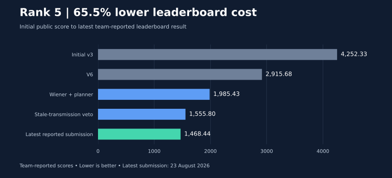
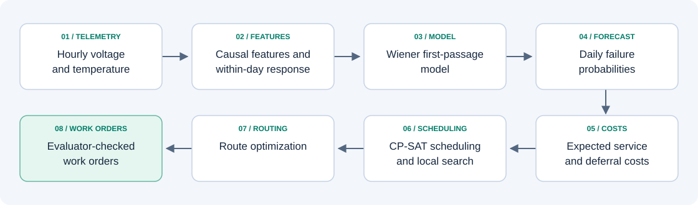

# BatterySwapAI 2026

### Predict battery failures. Turn uncertainty into an actionable service plan.

An end-to-end predictive maintenance system for building sensor fleets: **probabilistic battery lifetime forecasting**, **cost-aware scheduling**, and **route optimization**. Built for the NORA BatterySwapAI 2026 competition by **Team Dynamic Duo**.

[](https://github.com/rabrie10/BatterySwapAI2026-MR/actions/workflows/ci.yml)
[](#try-the-demo)
[](LICENSE)

[Results & evidence](docs/RESULTS.md) · [Technical case study](docs/CASE_STUDY.md) · [Run locally](docs/REPRODUCIBILITY.md) · [Architecture](docs/ARCHITECTURE.md)

## Results at a glance

| Outcome | Quantified result | Evaluation context |
|---|---:|---|
| **Leaderboard result** | **5th place · 1468.44** | Team-reported leaderboard entry, submitted 23 August 2026; lower is better |
| **Cost reduction from initial public submission** | **65.5%** | Initial public **4252.33 → 1468.44** latest reported leaderboard score |
| **Failure ranking** | **0.9823 ROC-AUC** | Building-grouped out-of-fold predictions; 88,013 cutoff examples |
| **Precision among the top 50 predictions** | **72%** | Same out-of-fold report; overall event prevalence **0.979%** |
| **Local planning cost reduction vs. no service** | **31.0%** | Historical V7 configuration: **3324.7 → 2293.2**, mean over 48 train scenarios |



The **rank 5 / 1468.44** result is from a team-provided leaderboard transcription for **23 August 2026, 23:58:31**. The results ledger records evaluation context and provenance for each claim. See the [results ledger and full cost breakdown](docs/RESULTS.md). Local results and forecast metrics use different evaluation settings and are not substitutes for public performance. Competition cost units do not represent measured financial savings.

## The engineering problem

A low-voltage reading alone does not tell a maintenance team which building to visit next. Replacing too early wastes useful battery life; replacing too late causes expensive emergency work. Travel time and worker capacity couple the decisions across an entire fleet.

This system turns hourly voltage and temperature histories into daily failure probabilities, then selects **which batteries to service, on which day, and in what visit order** over a 42-day planning horizon. It optimizes the evaluator's asymmetric costs: late replacement costs **20 times more per day** than early replacement.



## What makes this project interesting

- **Uses information daily smoothing discards.** Within-day voltage response to temperature provides a degradation signal beyond the smoothed trend. The fitted model uses **64 causal features** and **546,042 increment windows**.
- **Predicts a distribution.** A Wiener first-passage model estimates the probability of reaching the failure threshold across multiple horizons, allowing the planner to price uncertainty directly.
- **Connects ML to operations.** OR-Tools CP-SAT jointly chooses service or deferral and assigns days; routing uses Held–Karp for small routes and insertion plus 2-opt for larger routes.
- **Validates against the deployment split.** Building-grouped folds prevent a device from being scored by a model trained on its own building. The experiment notes also examine overlapping scenarios and local/public mismatch.
- **Checks the final decision.** Forecast-contract validation, official evaluator checks, deterministic seeds, and a runtime governor support the competition's 30-minute execution limit.

## Try the demo

**Python 3.12.** From the repository root:

```bash
python -m venv .venv
# macOS / Linux
source .venv/bin/activate
# Windows PowerShell: .venv\Scripts\Activate.ps1
python -m pip install -r requirements.portfolio.txt
python tools/demo.py
```

Open **`outputs/demo/index.html`** to inspect failure curves, the service schedule, and evaluator checks. CSV and JSON outputs are saved alongside it. The default uses synthetic probabilities and the real planner; no dataset, pretrained artifact, or external account is needed.

With the Git LFS model downloaded, also try the shipped forecasting model on synthetic telemetry:

```bash
git lfs install
git lfs pull --include="models/v7_wiener.joblib"
python tools/demo.py --model
```

Both modes are illustrative walkthroughs. See the [demo guide](docs/DEMO.md) for scope and expected outputs, and [reproducibility guide](docs/REPRODUCIBILITY.md) for real-data training and evaluation.

## Explore the implementation

| Path | Purpose |
|---|---|
| [`bsai/`](bsai/) | Current forecasting pipeline: smoothing, causal features, within-day statistics, Wiener model |
| [`batteryswap_solution/`](batteryswap_solution/) | Forecast contract, expected costs, CP-SAT scheduling, routing, evaluator replay |
| [`script.py`](script.py) | Official competition entry point and runtime budget handling |
| [`bsai/config.py`](bsai/config.py) | Shared shipped settings for training, validation, and submission |
| [`tests/`](tests/) | Forecast, scheduling, routing, runtime, and evaluator-parity regression tests |
| [`tools/`](tools/) | Training, validation, demo, and research utilities |
| [`docs/`](docs/README.md) | Case study, evidence, setup, architecture, and indexed experiment history |
| [`src/`](src/), [`notebooks/`](notebooks/README.md) | Earlier baselines and exploratory work; retained for research context |

## Checks

The GitHub Actions workflow runs dataset-independent regression tests, the synthetic planning demo, and checks on documentation links and result calculations. It does not download the competition dataset or model weights.

```bash
python -m unittest tests.test_task2 tests.test_runtime tests.test_task1_forecast tests.test_candidates tests.test_blend tests.test_configuration -v
python tools/check_portfolio.py
```

The [full test suite](docs/REPRODUCIBILITY.md#tests) adds data-dependent checks when the training dataset and model are present.

## Authors and attribution

**Mahdi Nasser and Robel Weldemichael Ghebremedhin — Team Dynamic Duo.** Both authors collaborated across forecasting, optimization, experiments, and integration throughout the project. The [case study](docs/CASE_STUDY.md) explains the engineering decisions and tradeoffs.

Participant-authored code is [MIT licensed](LICENSE). The competition dataset, official evaluator, and third-party dependencies retain their own terms. No external dataset or third-party pretrained model weights were used in the competition solution. See the [model card](models/README.md) for the shipped artifact and its limitations.
