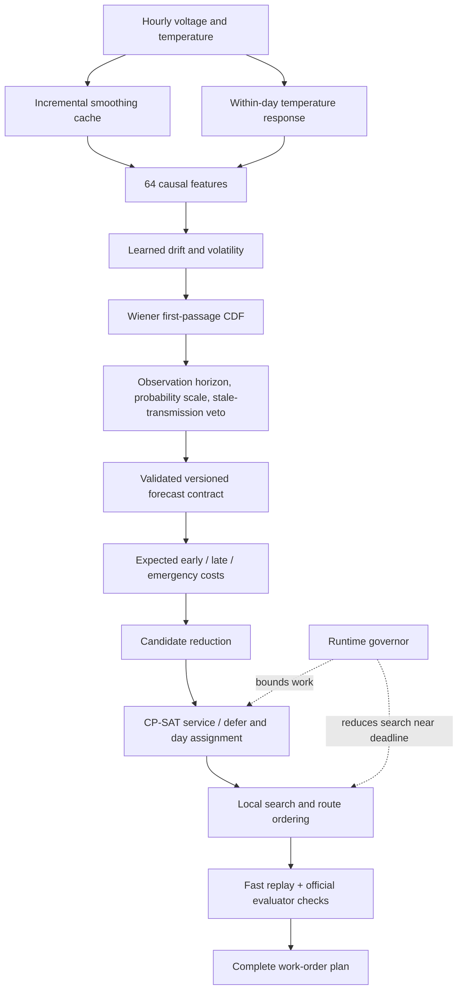

# Architecture

The system combines probabilistic prognostics with operational optimization. The official entry point is [`script.py`](../script.py); the deployed configuration is shared through [`bsai/config.py`](../bsai/config.py).

## Forecasting

[`bsai/smoothing.py`](../bsai/smoothing.py) incrementally reproduces the official smoothing operation. [`shape.py`](../bsai/shape.py) retains within-day statistics before that smoothing discards them. [`features.py`](../bsai/features.py) combines voltage history, temperature, seasonal context, and within-day response using information available at the prediction cutoff.

[`wiener.py`](../bsai/wiener.py) fits gradient-boosted regressors for voltage drift and volatility. The first-passage distribution estimates when a stochastic voltage trajectory first crosses the 2.4 V threshold. It produces a coherent curve across horizons instead of an isolated lifetime estimate.

[`forecaster.py`](../bsai/forecaster.py) turns model outputs into evaluator-relevant event probabilities. It accounts for observation ending before failure is recorded, applies the shipped probability scale, and vetoes near-threshold devices with more than 14 days of transmission silence. This last rule is specific to recorded failures in the competition; it is not a general claim that a silent physical battery is safe.

If observation ends within the planning window, any risk removed by the veto moves to the unobserved category. It cannot become a recorded failure beyond the observation period. A synthetic regression test checks this alongside probability mass conservation.

## Contract between ML and planning

[`forecast.py`](../batteryswap_solution/forecast.py) defines a versioned `RiskForecast`: daily cumulative failure probabilities, observed survival beyond the horizon, and probability of no observed failure. Validation checks identities, date coverage, probability bounds, monotonicity, and mass conservation.

The planner consumes this interface rather than the model class. Forecasting experiments can therefore replace the model without rewriting scheduling or routing. The synthetic demo exercises the same boundary with illustrative distributions.

## Decision optimization

[`costs.py`](../batteryswap_solution/costs.py) integrates the forecast with the evaluator's early, late, and emergency penalties. [`optimizer.py`](../batteryswap_solution/optimizer.py) chooses which batteries to service and assigns days using OR-Tools CP-SAT. Soft penalties preserve the evaluator's actual tradeoffs rather than making every capacity limit an absolute prohibition.

[`planner.py`](../batteryswap_solution/planner.py) reduces the candidate set and improves the assignment with local search. [`routing.py`](../batteryswap_solution/routing.py) orders building visits using exact Held–Karp routes on small days and insertion plus 2-opt above that size.

## Validation and execution budget

[`replay.py`](../batteryswap_solution/replay.py) cheaply scores operational moves; regression tests compare it to the official evaluator. Final plans are checked through the official evaluation interface. Valid fallback plans keep the competition runner operational after errors; validation counts fallbacks and fails the run so errors cannot look like legitimate benchmark results.

[`runtime.py`](../bsai/runtime.py) governs the 30-minute competition budget, lowering search effort near the deadline and eventually deferring remaining work. One planner instance is reused across scenarios so incremental caches survive.

## Current and historical code

`bsai/` and `batteryswap_solution/` implement the current submission. `src/` contains earlier Cox and hazard-model baselines and remains importable for historical model artifacts and regression tests. `tools/` includes both supported entry points and exploratory diagnostics; see the [tool index](../tools/README.md). Historical documents are indexed separately in the [documentation guide](README.md).
